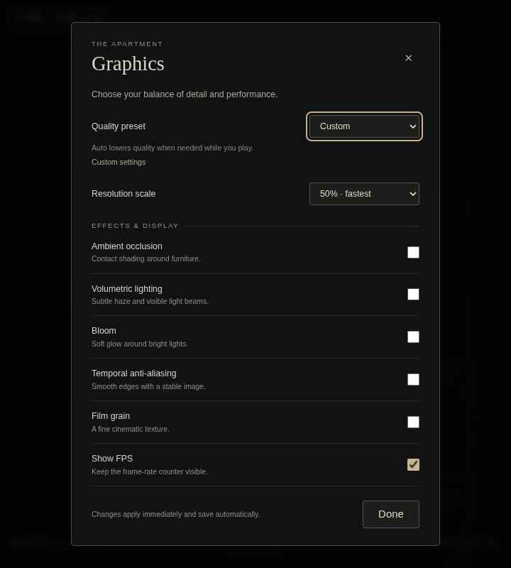
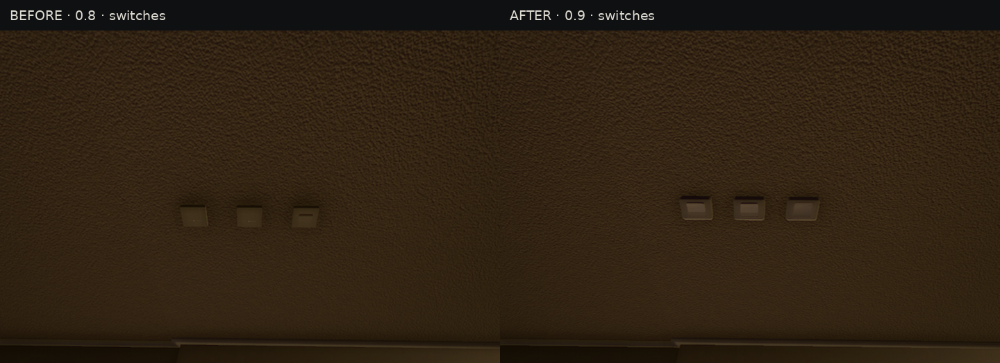
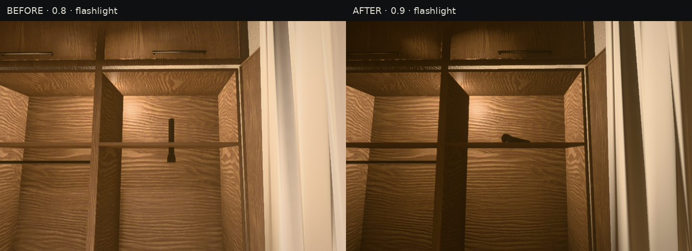
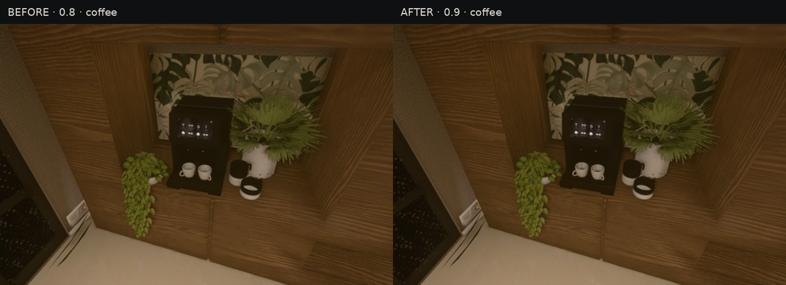
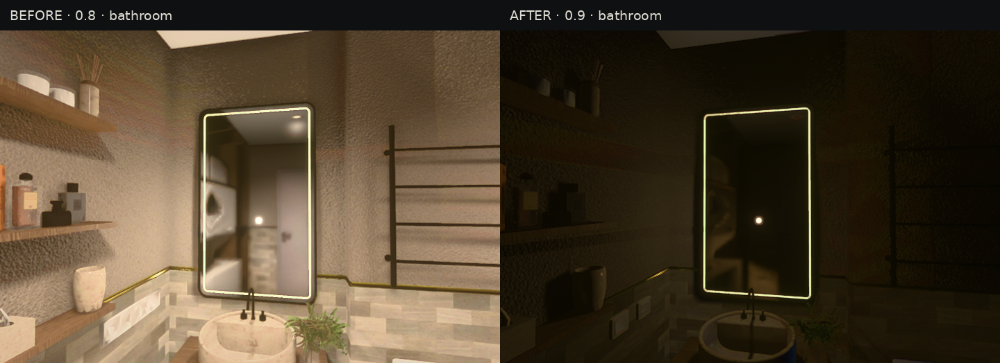
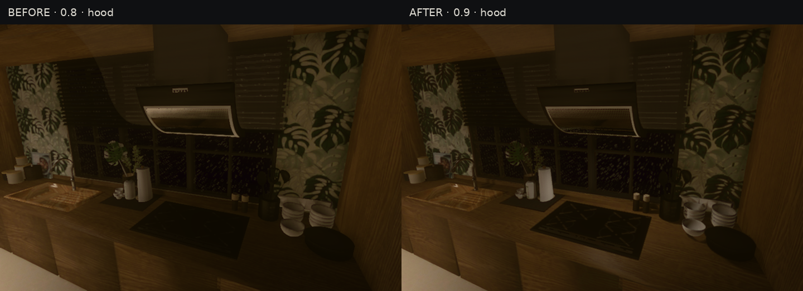

# Review 0.9 comparisons

Original 0.8 on the left; review 0.9 on the right. These are real engine captures with the same camera, exposure and Medium settings. The requested initial lighting defaults differ. Object-comparison HUDs are hidden so the software renderer's FPS does not obscure the geometry. Images are not colour-retouched.

## Graphics menu

## Switches

## Flashlight shelf placement

## Coffee machine

## Bathroom lighting

## Extractor hood light

[Changes, controls and validation](../REVIEW_09.md)
