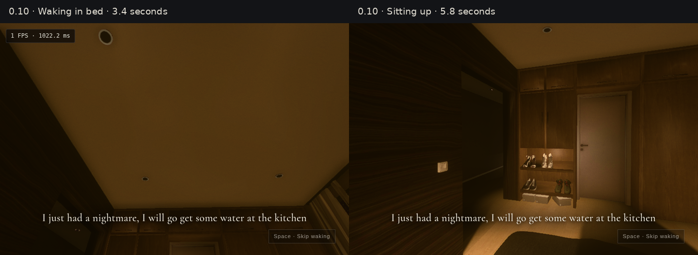
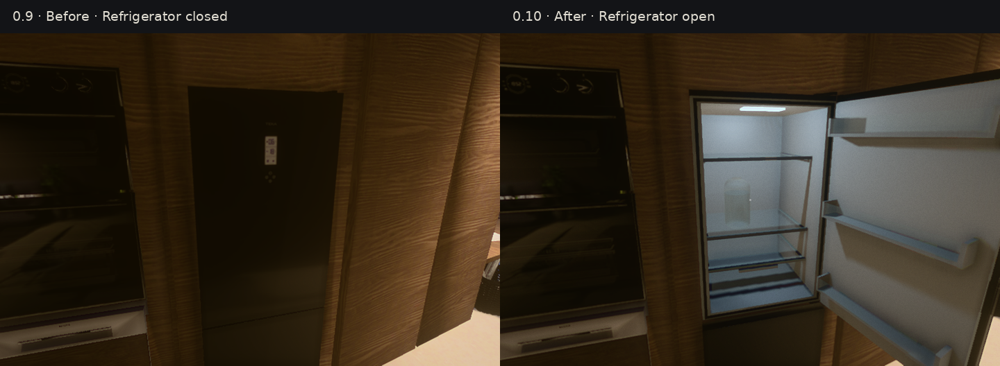
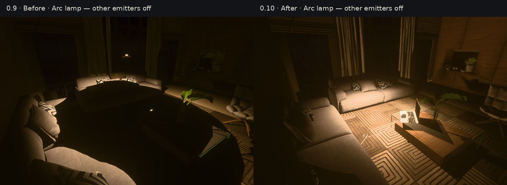
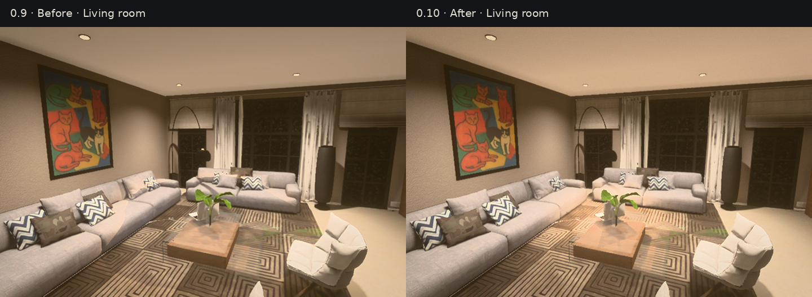
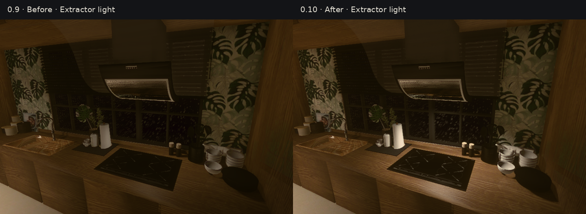
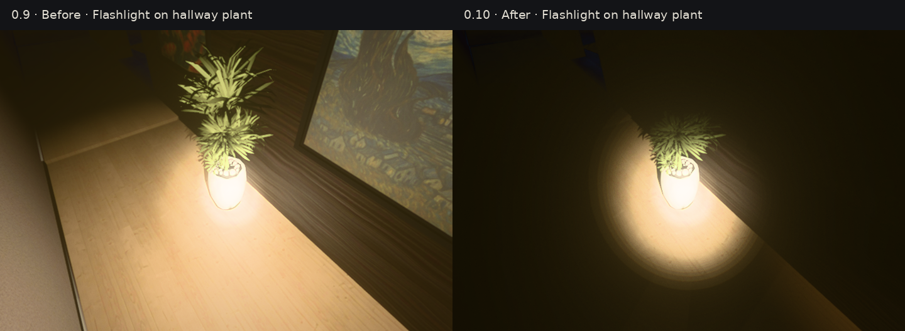
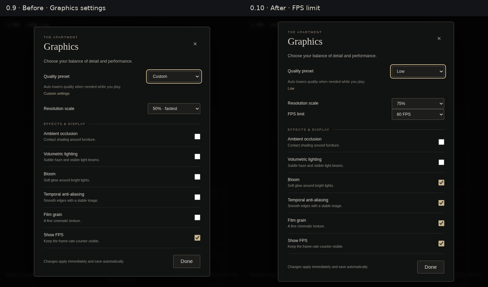

# Review 0.10 comparisons

Published 0.9 is on the left; review 0.10 is on the right. These are real engine captures with matching camera, Medium quality, fixed exposure 1 and 720×480 viewport. Random lightning is disabled and noise is seeded. Grain animation is frozen so both versions can be inspected; its stronger opacity is retained. FPS is hidden only for scene comparisons. Images are not color-retouched.

## First waking sequence

Two frames of the new opening: waking in bed at 3.4 seconds, then sitting and turning toward the bedside at 5.8 seconds. Both are real timeline poses held in the renderer for inspection. Camera positions differ as the animation progresses.

## Refrigerator and water jar

Matching camera, with the old closed refrigerator on the left and the new open interaction on the right. The cabinet light, shelves, inner door bins, authored glass jar and water are visible. The first local open capture precedes the final 4.4 mm shelf-contact adjustment; it is replaced with a hosted final-build capture after verification.

## Sofa arc lamp, isolated

Other emitters are off and probes are recaptured in both versions. The old shade blocked the central beam; the corrected emitter lights the center and preserves shadows from the furniture.

## Living room with initial lights

## Extractor light

## Flashlight on the hallway plant

The old unshadowed return flooded the wall and floor through the plant. Its replacement traces the real pot and returns a smaller amount of shadowed light. The main flashlight beam still casts the plant's shadows.

## Graphics and FPS limit

The new FPS selector works independently of the quality preset and counter visibility. These are native menu screenshots; saved settings shown in the two captures differ.

Camera position → target, in world metres:

- Living: `[-1.5,1.77,1.5]` → `[-4.6,1.3,2.6]`.
- Extractor: `[-0.4,1.75,0.4]` → `[-0.94,1.35,-1.13]`.
- Arc isolated: `[-3,1.60,3.9]` → `[-4.88,0.65,2.70]`.
- Refrigerator: `[1.12,1.85,0.68]` → `[1.55,1.47,-0.70]`.

[Changes, controls and validation](../REVIEW_10.md)
