# Review 0.11 captures

These are unretouched game renders. Before is the published 0.10 (`7c8af57`); after is 0.11. Room/fridge comparisons use identical cameras, 720×480 viewport, Medium preset, fixed exposure 1, seeded noise and disabled random lightning. The updated Medium preset renders at 85% rather than 100%; shadow/effect budgets also differ as documented in REVIEW_11.md. Grain animation and the FPS overlay are frozen/hidden for inspection.

| View | Before | After |
| --- | --- | --- |
| Living room | 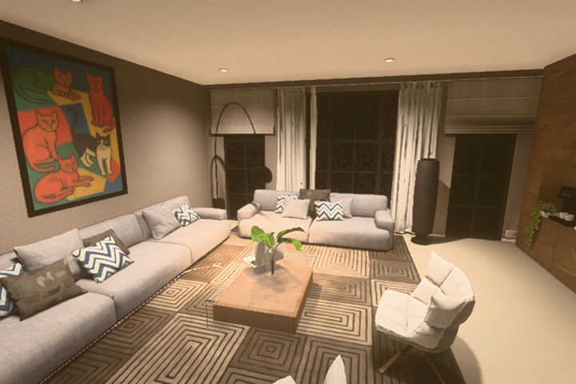 | 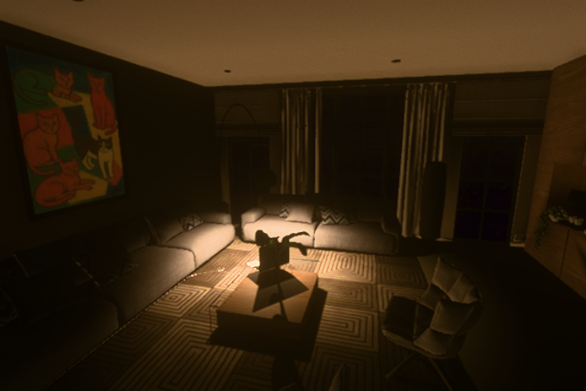 |
| Office | 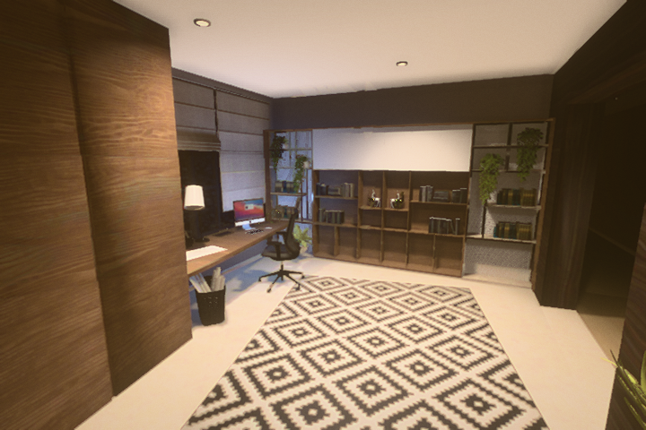 | 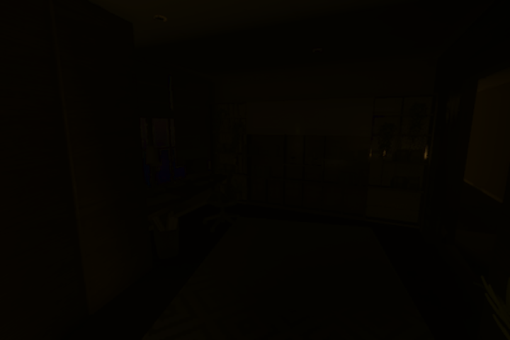 |
| Bedroom | 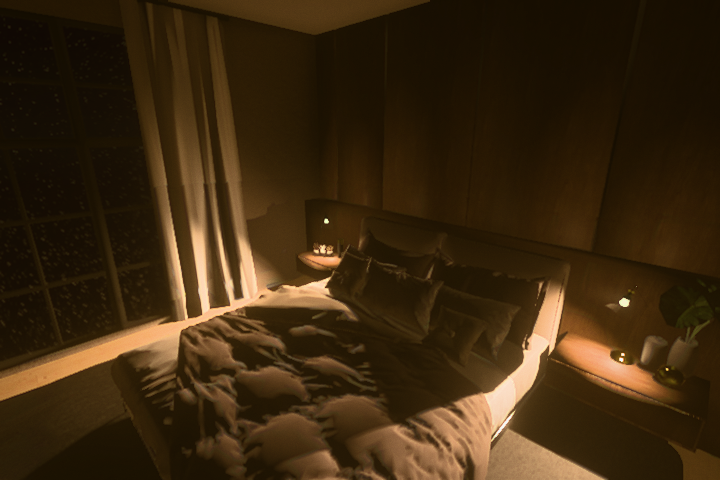 | 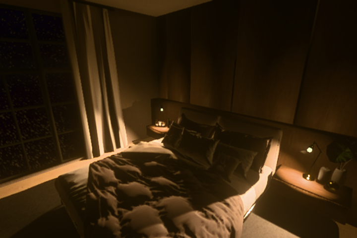 |
| Open refrigerator | 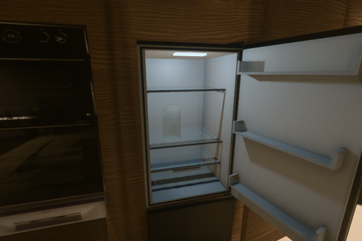 | 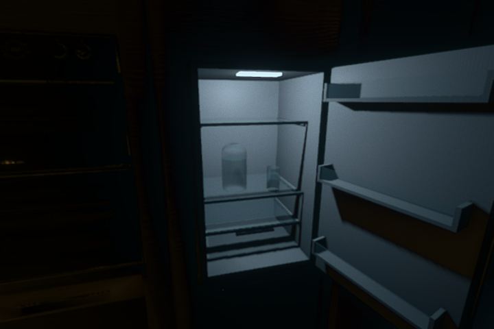 |

The drinking images use the final build, native E opening followed by a second E from the same view, Medium quality and WebGPU. Animation poses are deliberately frozen at 0.8, 1.8, 2.7 and 4.25 seconds to inspect the reach, lift, grip and sip. CPU SwiftShader throughput is not a desktop hardware benchmark.

| Reach | Lift |
| --- | --- |
| 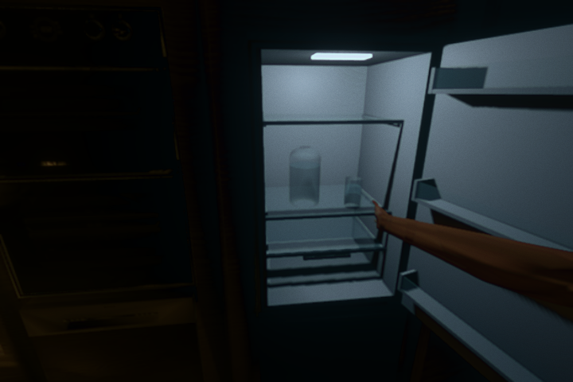 | 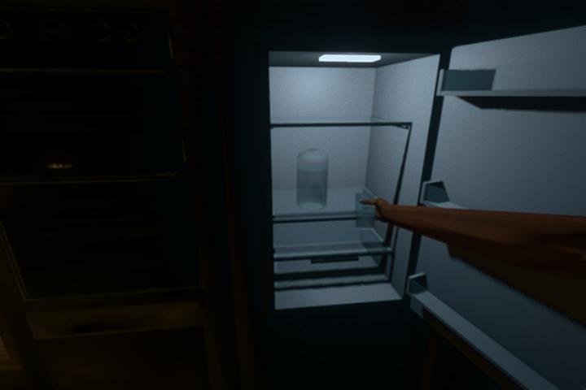 |

| Raised glass | Sip |
| --- | --- |
| 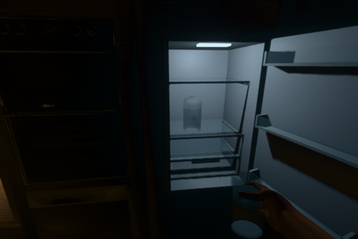 | 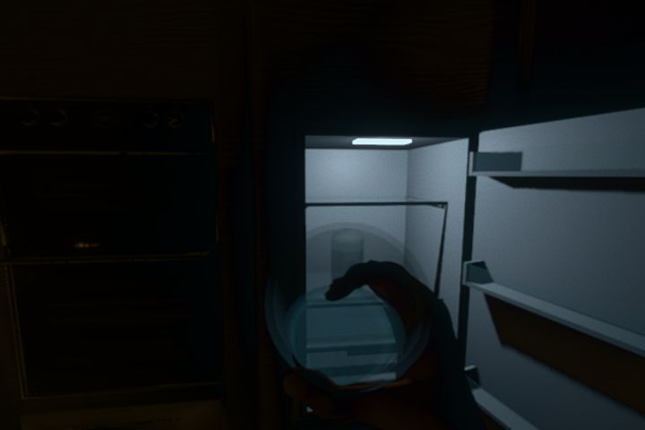 |
