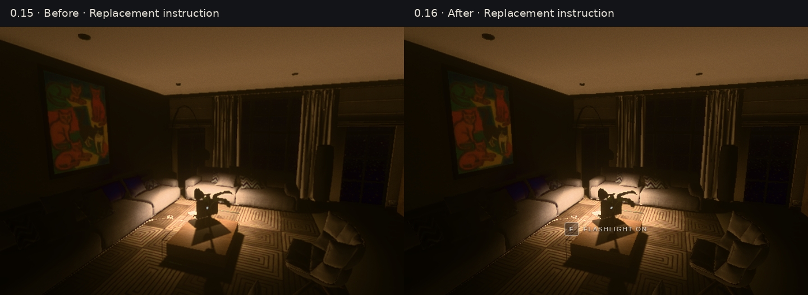
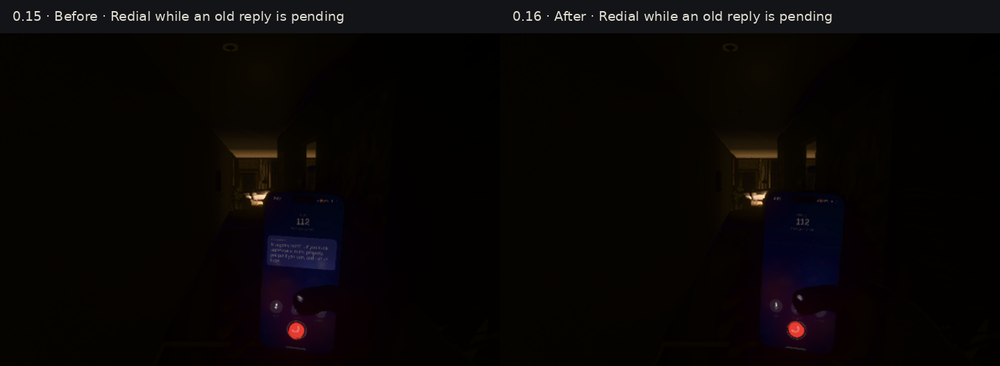
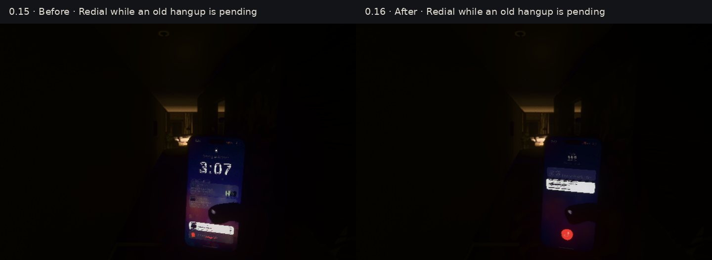
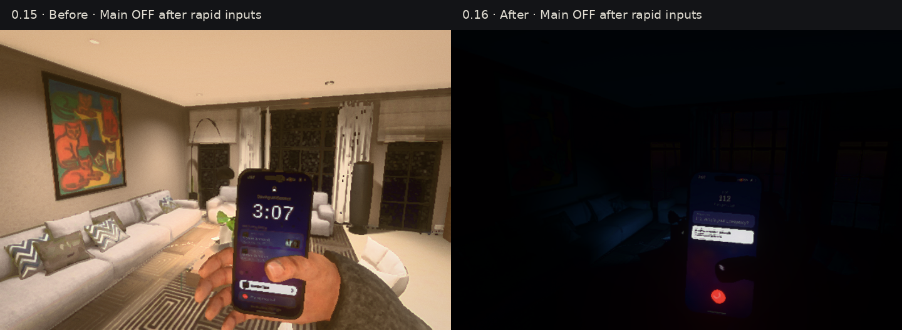

# Review 0.16 — matched bug reproductions

Build 0.15 is on the left, Codex's 0.16 bug pass on the right. Both use the real game, the same inspection script, 720×480 viewport, Medium quality, fixed exposure 1 and fixed cameras. Grain is frozen and random lightning is disabled. Images are not color-retouched; only the labels are added outside the captured frame. CPU SwiftShader rendering checks correctness, not desktop GPU performance.

## New instructions survive an old fade

An old crouch prompt starts fading; the flashlight instruction replaces it. The old hide callback incorrectly removed the replacement in 0.15. The actual HUD callbacks are advanced with a controlled clock in both captures.

## An abandoned call cannot speak into a redial

The same sequence in each version: call A, answer, hang up, redial B, then advance the real story scheduler until A's old reply is due. In 0.15 the old reply overwrites B's dialing screen; 0.16 keeps B's own call state. Transient HUD voice captions are hidden to inspect the phone's actual canvas.

## An abandoned call cannot hang up the new one

Later in the same sequence, A's old auto-hangup incorrectly returns the phone to its lock screen in 0.15. B remains connected in 0.16.

## Main off means lights off

The same rapid off → restore → off sequence is held at 600 ms after the last input. The main switch is off in both images. An older restore transition incorrectly leaves the flat bright in 0.15; the corrected transition turns the lights off. The phone remains battery powered and also reflects the independent call fixes above.

Reproduce with `tools/perf/scene-shots.mjs` and `tools/perf/scenes/review-016.mjs` against frozen before/after builds. Inspection captures may use `--skip-warm`; the separate full runtime checks use the normal warm-up.

[Changes, baseline comparison and continuation](../REVIEW_16.md) · [Validation data](validation.json)
