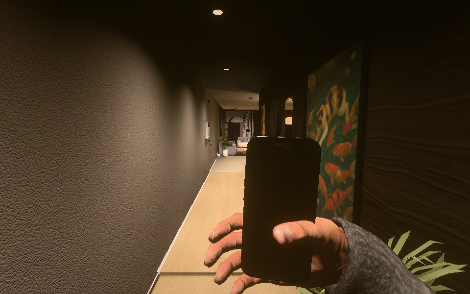
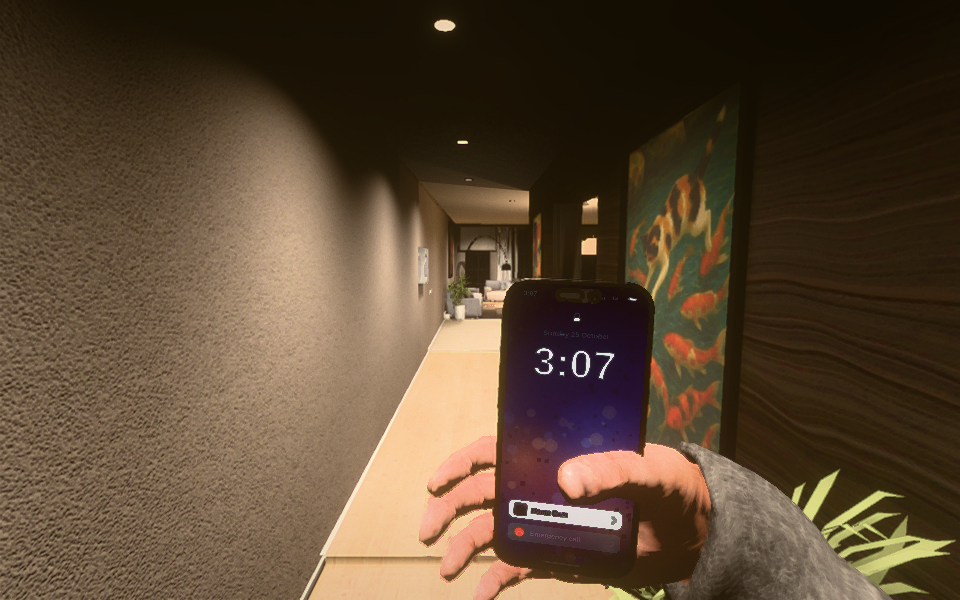
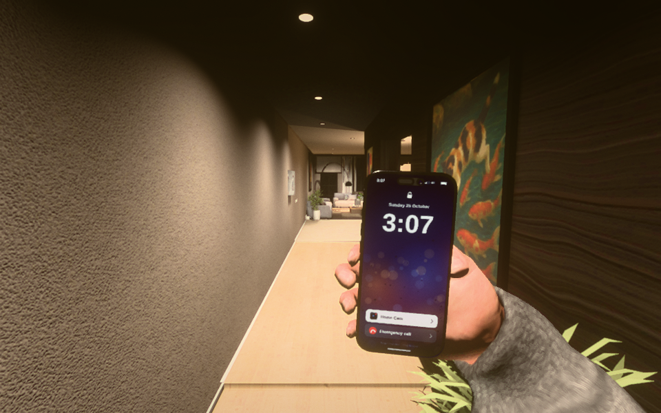
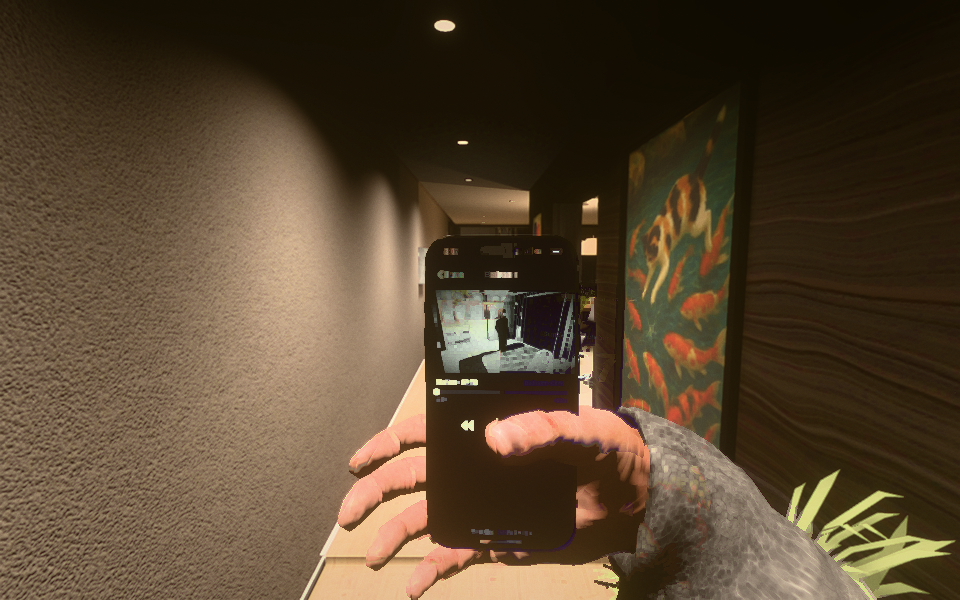
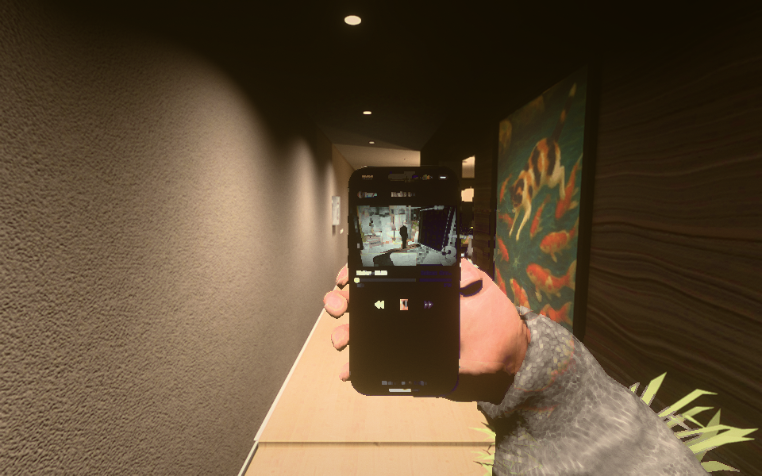
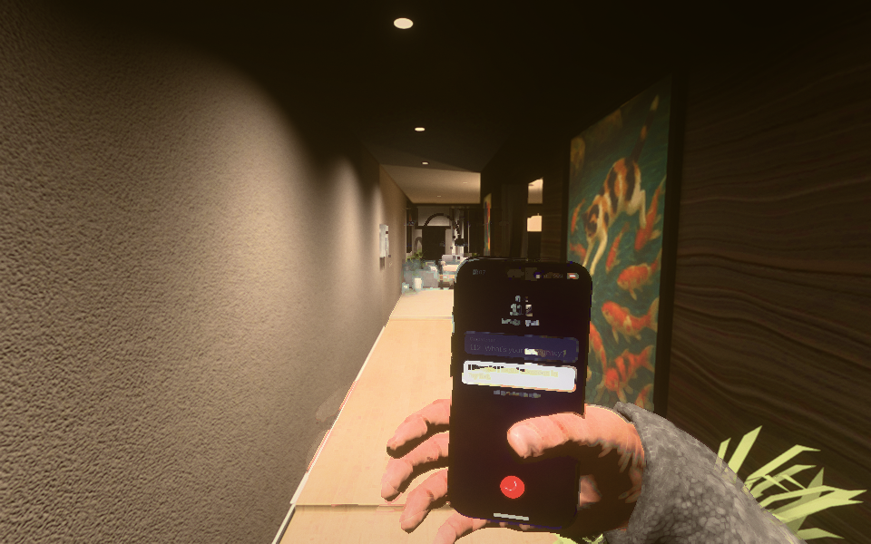
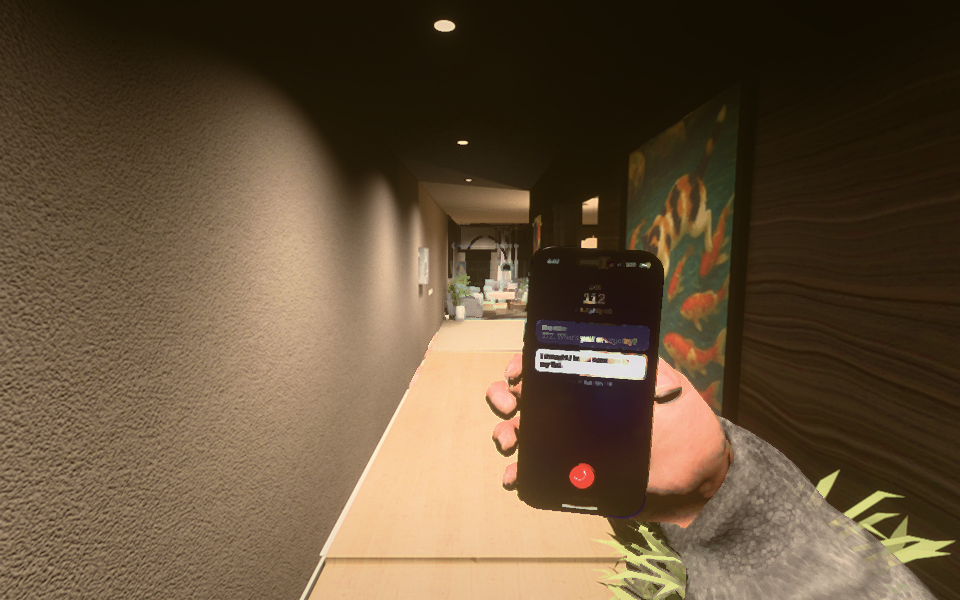

# Review 0.17 — phone in hand

Build 0.16 on the left, 0.17 on the right. These are unedited screenshots of the real game, captured with the same script, camera, 960×600 viewport, Medium quality, fixed exposure 1, seeded randomness and apartment lights. Grain is frozen and random lightning disabled. Open either image for full resolution. Software rendering verifies appearance and correctness; it is not a desktop FPS benchmark.

## First pickup, without charging

The actual nightstand pickup and Q action. Before: a dead phone. After: the lock screen immediately, 100% charge, with working camera and emergency call. Charging is optional, including when continuing an old save.

| Before — 0.16 | After — 0.17 |
| --- | --- |
|  |  |

## Grip and reading position

Both phones are deliberately set to 100% on the same lock screen to isolate the grip and framing change. The old glass-shaped grip crossed the display and left fingers floating. The replacement fits individual fingers to the actual phone, rests the thumb beside the glass, and leaves the full display in view.

| Before — 0.16 | After — 0.17 |
| --- | --- |
|  |  |

## Watching a clip

The phone eases closer to the centre for camera playback. Its hand stays attached during the transition. Idle breathing, restrained look inertia and walking response use play time and freeze during pause.

| Before — 0.16 | After — 0.17 |
| --- | --- |
|  |  |

## Emergency call

The screen stays clear of the thumb. Right click/Backspace now hangs up during dialogue, and Hang up remains selectable while answers are offered. A callback stops camera playback so video cannot obscure its incoming-call screen.

| Before — 0.16 | After — 0.17 |
| --- | --- |
|  |  |

Reproduce with `tools/perf/scene-shots.mjs` and `tools/perf/scenes/review-017.mjs` against the frozen before/after builds. The capture setups are identical; the lock/video/call shots explicitly set their app state. The pickup shot uses each build's actual initial battery state. Later nonvisual callback/story fixes do not change these inspection setups. The final production bundle is checked separately through the normal shader warm-up and full gameplay audit.

The [offline fit check](../../tools/phone/grip-check.mjs) uses the shipped meshes, actual runtime arm pose and screen projection. The old grip obscures the display with 663 skin triangles; the new grip has zero overlap in lock, video and turning views, submillimetre conservative skin compression, and fingertips within 3 mm of the actual case. See [before](grip-before.json) and [after](grip-after.json).

[Changes and validation](../REVIEW_17.md) · [Continuation handoff](../HANDOFF.md)
