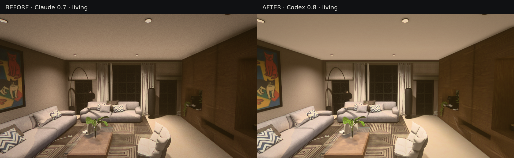
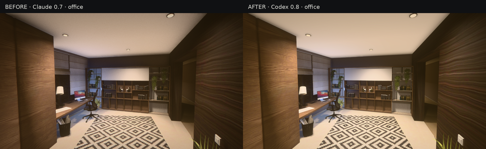
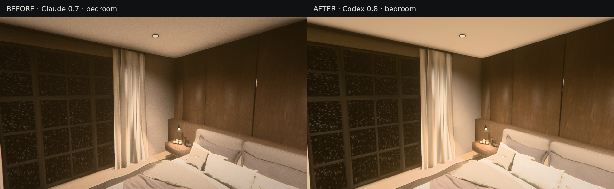
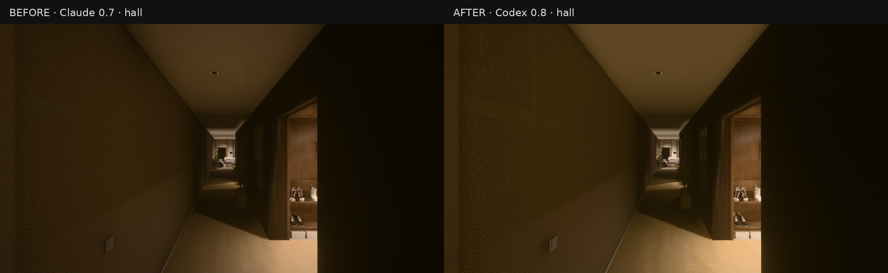

# Matched comparison views

Left: Claude build 0.7 (`7b93acb`). Right: Codex build 0.8.
Both captures use 960×540, quality 3, WebGL 2, fixed exposure 1 and the same camera poses. The images have not been colour-corrected or retouched. Labels and side-by-side layout are added outside the image area.

## Living room

## Office

## Bedroom

## Entrance hall

See [the full changes and capture procedure](../CODEX_ENVIRONMENT_PASS.md). The ordinary game uses adaptive exposure; fixed exposure here makes the lighting comparison consistent.
